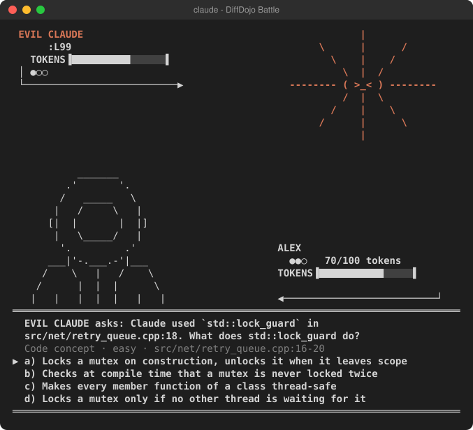

# DiffDojo

**Learn from the code Claude writes for you — while it writes it.**

<p align="center"></p>

When Claude Code is busy working on your project, you're usually just waiting. DiffDojo turns that waiting time into practice: after each change Claude makes, it asks you a few short questions about *that exact change*. Answering them means you actually review and understand the code instead of skimming it.

> DiffDojo is an independent, open-source plugin for Claude Code. It is not affiliated with or endorsed by Anthropic.

No accounts, no servers. Your progress stays on your machine; the only thing that leaves it is short excerpts of Claude's changes, sent to Claude on your own plan so it can write questions about them (one setting turns that off).

---

## What kind of questions?

**Claude's questions about your project** — the main course
- After each change, Claude itself writes technical questions about **that change in your project**: why a heap and not a list here, what `due(5)` returns when two jobs tie, what happens to `recent` after 12 jobs. A cheap model (Claude Haiku) writes them in the background on your own plan, so your main conversation never sees them and Claude's work isn't slowed down. A second, blind call answers each one, and only questions both calls agree on are kept.

**Technical questions DiffDojo builds itself** — checked by running or reading the code
- *What is this?* Claude used `std::lock_guard`, `heapq.heappush`, `Promise.all` or `EPOLLET` in its change. What does it do, and why does it matter here?
- *What does this return?* Predict the output of a function Claude wrote for a given input. (DiffDojo actually runs it to know the answer.)
- *What is this data structure?* What container did Claude use for this, and what is its complexity?

**Concept quizzes** — on the topics you're working in
- 270+ hand-written questions on C++, concurrency, Linux networking, Python, JavaScript/TypeScript, and algorithms. Writing epoll code? You'll get epoll questions.

**Review extras** (in the plain quiz, not in battles)
- *Spot the bug:* a copy of one of Claude's functions with one line quietly broken, at most one per change.
- *Write a test* that would catch a hidden bug, and *why did Claude do this?* checked against what Claude said in your session.

DiffDojo's own questions are checked against real evidence: running the code, reading it, or reviewed answer keys. Claude's questions are double-checked by a blind second answer; they earn a bit less XP and never decide a belt exam.

## Battle mode

While Claude works, questions turn into a retro turn-based fight above your prompt, in the style of old handheld RPG battles with original ASCII-art characters, drawn right on your terminal in its own colors. The screenshot at the top is a real frame: Evil Claude, the final boss of Professional mode, asks about a line in the change Claude just made.

- **Up/down to pick an answer, Enter to attack.** A correct answer hits the enemy; a wrong one lets it hit you (and sometimes it misses).
- Beat an enemy and your HP is fully restored for the next one. You have **3 lives**: lose them all and you start the ladder over.
- **Modes:** Easy, Medium, Hard, **Professional** (whose final boss is **Evil Claude**, an angry orange starburst) and **Endless** (waves get stronger; your best wave is recorded).
- **Animated:** enemies slide in with a "wants to fight!" intro, every sprite has an idle loop, hits shake and flash the target, HP bars drain, and the text box arrow blinks.
- **Questions about Claude's code** are generated in the background while it works (from each edit, and again when the turn ends), and they show up in the fight: Professional mode asks them first.
- Battle answers count like any other: XP, belts, stats, plus a trophy for clearing each ladder.
- You fight under your own name: your git user name, or your system username. Pick another with `diffdojo config set playerName "Alex" --global`.
- In Claude Code: `/battle` opens it any time, `/battle menu` picks a new mode, `/battle off` switches back to the plain question box. Esc returns to your prompt.
- Works in any folder, git or not.

**The fight didn't open when I sent a prompt?** Check that battle mode is on (`/battle on`) and DiffDojo isn't stopped in that project (`/diffdojo:start`). In a narrow terminal Claude Code may hold back panes a plugin opens by itself: type `/battle` to open it, or widen the window.

## No Mercy mode

For when you really want to keep up with Claude: **every edit waits for you.** No Mercy's boss, **SKYNET**, stands between Claude and your files. Before Claude's change reaches the file, SKYNET asks you one question about that exact change, in Claude Code's own question dialog:

- *Which line did Claude write here?* The new code with one line hidden, the real line among look-alikes (`<` vs `<=`, swapped names, off-by-one numbers).
- *What does this do?* When the change uses something like `Promise.all`, `heapq.heappush` or `std::lock_guard`.

**Answer right**, you beat SKYNET and the edit goes through (with XP). **Answer wrong, or close the question,** SKYNET wins: the edit is rejected and Claude stops working, so you can look at what it was doing before you let it go on.

```
/nomercy on     # in Claude Code
/nomercy off
```

Edits to non-code files (Markdown, JSON...) pass without a question. If something goes wrong building a question, the edit goes through rather than blocking your work.

## Try it without prompting Claude

```bash
diffdojo demo      # makes ~/diffdojo-demo: a small project with a simulated Claude change, already turned into questions
cd ~/diffdojo-demo
diffdojo battle    # play the battle right in this terminal (no Claude Code needed)
```

Or open the demo in Claude Code (`claude --plugin-dir /path/to/Diffdojo`) and type `/battle` or `/dojo`. No need to ask Claude for anything first. `diffdojo battle` works in any project, too; `diffdojo battle --snapshot` prints a few frames instead of playing.

## Earn your belts

Correct answers earn XP. XP unlocks **belt exams** — White → Yellow → Orange → Green → Blue → Brown → Black — separately for each topic (C++, Python, Networking…). Higher belts unlock harder challenges like **boss fights** (find 3 hidden bugs in one file) and **audit mode** (is there a bug at all?).

The biggest reward? **Catching a real bug in Claude's code** and proving it with a failing test. That earns a trophy and a saved bug report.

Show it off with `diffdojo badge`, which makes a little SVG badge for your GitHub profile.

---

## Getting started

**You need:** [Node.js](https://nodejs.org) 22.5 or newer and git. That's it — no `npm install` required.
*(Optional: Python and a C++ compiler unlock more question types.)*

**1. Install the plugin**

In Claude Code, type:

```
/plugin install diffdojo --marketplace Ninjacornix/Diffdojo
```

Answer `y` to add the marketplace and pick a scope (user is the usual choice). From a shell, the same thing is `claude plugin install diffdojo --marketplace Ninjacornix/Diffdojo`. In the desktop app: click + next to the prompt box, then Plugins, Add marketplace with `Ninjacornix/Diffdojo`, then Add plugin.

Updates arrive with `/plugin` (or `claude plugin update diffdojo`).

**2. Or run it from a checkout** (for hacking on DiffDojo itself)

```bash
git clone https://github.com/Ninjacornix/Diffdojo.git
cd your-project
claude --plugin-dir /path/to/Diffdojo
```

For the terminal commands (`diffdojo quiz`, `diffdojo battle`, `diffdojo demo`) run `npm link` in the checkout, or use `node /path/to/Diffdojo/bin/diffdojo <command>`. Inside Claude Code the plugin puts `diffdojo` on the Bash tool's PATH by itself.

**3. That's it — it's already on**

DiffDojo starts automatically in every project you open with the plugin enabled, **git or not**; there's nothing to switch on. In a folder without git, DiffDojo tracks Claude's changes with a private shadow repository in `~/.diffdojo/`, so nothing is ever written into your folder. (It skips your home folder and drive roots: open Claude Code in a project folder.) Your XP, belts and trophies are tracked across all your projects (`diffdojo stats` shows them, plus a list of every project).

Optional: tell it how to run a project's tests, which unlocks more question types:

```
/diffdojo:start npm test
```

Don't want it in some project? Type `/diffdojo:stop` there. Prefer to opt in per project instead? Run `diffdojo config set autoEnable false --global` and use `/diffdojo:start` where you want it.

**4. Keep working — questions pop up right inside Claude Code**

While Claude is working, the current question appears in a box just above your prompt:

```
╭──────────────────────────────────────────────────────────────╮
│ DiffDojo · Design · Data structure · verified · 10 XP     │
│ `jobs` is declared in sched.py:8 in Claude's change. What is it? │
│ 1 a) dict                                                    │
│ 2 b) list used as a binary heap (heapq)                      │
│ 3 c) set                                                     │
│ 4 d) tuple                                                   │
│ Press 1-4 in the empty prompt · Skip  Snooze  Bad question  Hide │
╰──────────────────────────────────────────────────────────────╯
```

- **Multiple choice:** just press **1–4** while your prompt is empty.
- **Typed answers** (line numbers, outputs): press **ctrl+x tab** to jump into the answer box, type, and hit Enter.
- **`/dojo`** opens a side pane with the full question and its code.
- The status line shows how many questions are waiting, and a small pop-up tells you when new ones arrive.

Questions about a change appear shortly after Claude finishes it; in between, you get concept quizzes on the topics you're working in. Answer whenever you like, or not at all — none of this is ever shown to Claude.

**Prefer a separate window?** Use `diffdojo quiz` in a second terminal, or `diffdojo serve` for a browser page.
*(No `npm link`? Use `node /path/to/Diffdojo/bin/diffdojo quiz`.)*

---

## Handy commands

| Command | What it does |
|---|---|
| `/dojo` (in Claude Code) | Open the quiz pane beside the chat |
| `/battle` (in Claude Code) | Open the battle; `/battle menu`, `/battle off` |
| `/nomercy on` (in Claude Code) | Answer a question before each of Claude's edits is applied |
| `diffdojo quiz` | Answer your queued questions in a terminal |
| `diffdojo quiz --topic networking` | Practice a topic — no Claude session needed |
| `diffdojo stats` | Your belts, XP, accuracy, streak, trophies and projects — across everything (`--repo` for just this one) |
| `diffdojo review` | Retry questions you got wrong |
| `diffdojo exam cpp` | Take your next belt exam in a track |
| `diffdojo serve` | Quiz in your browser (local only) |
| `diffdojo badge` | Make a badge for your profile |
| `diffdojo doctor` | Check that everything is set up right |

While quizzing: type your answer, or `s` to skip, `z` to snooze, `b` to flag a bad question, `q` to quit.

In Claude Code: `/diffdojo:start`, `/diffdojo:stop`, `/diffdojo:stats`, `/diffdojo:report-bug`, `/diffdojo:topics`.

Run `diffdojo help` for everything else.

---

## Your data stays yours

- **Your choice where it runs.** It's on in every project folder by default, git or not; `/diffdojo:stop` turns it off for one project, and `diffdojo config set autoEnable false --global` makes it opt-in everywhere.
- **Stored locally.** Your progress and questions live in `~/.diffdojo/`, never in your repo, never on a server.
- **Never slows Claude down.** All the work happens in the background, after Claude finishes a turn.
- **Stays out of your conversation.** Nothing is ever injected into your chat with Claude; questions are written by a separate background call.
- **Safe with your code.** Code only ever runs in a temporary copy, and the only project command DiffDojo will run is the test command you gave it. Files like `.env` and keys are skipped, and anything that looks like a secret is filtered out.
- **Claude's code runs boxed in.** To check "what does this return?" answers, DiffDojo runs functions from Claude's change. On Linux (with bubblewrap) and macOS that happens in a sandbox with no network that can't write to your files; on Windows there's no sandbox, only a timeout and an environment stripped of API keys and tokens. Run `diffdojo config set snippetSandbox require --global` to skip those questions where no sandbox is available. Details in [Privacy & security](docs/PRIVACY_AND_SECURITY.md#execution-safety).
- **You're in control.** `diffdojo export` gives you all your data as one file; `diffdojo purge --yes` deletes it.

**Claude writes the questions (on by default):** after each change, DiffDojo runs `claude -p` on your own Claude plan with a cheap model (`claude-haiku-5-5`) and short excerpts of the changed code (at most ~160 lines, never files matching the deny list, never anything that looks like a secret). That's at most 30 small calls an hour. The excerpts are handled like any other Claude Code request under your account's terms. **For confidential code, turn it off:**

```bash
diffdojo config set model.enabled false            # this project
diffdojo config set model.enabled false --global   # every project
```

With it off, everything stays on your machine and you get DiffDojo's own questions only. `diffdojo config set model.model claude-sonnet-5-5` picks a different model.

---

## Contributing

Contributions are very welcome — especially **new quiz questions**! Packs are simple YAML files in [`packs/`](packs/). You can also keep your own private packs in `~/.diffdojo/packs/`.

```bash
npm test          # run the test suite
npm run test:ui   # the in-app UI tests (needs the claude CLI)
npm run pack-ci   # validate all question packs (and run their code snippets)
npm run lint      # syntax-check every source file
```

CI runs all of these on Linux, macOS and Windows for every pull request.

Want to know how it works under the hood? See the design docs:
[Product requirements](docs/PRODUCT_REQUIREMENTS.md) ·
[Architecture](docs/ARCHITECTURE.md) ·
[Questions & grading](docs/QUESTIONS_AND_GRADING.md) ·
[Rewards](docs/REWARDS.md) ·
[Privacy & security](docs/PRIVACY_AND_SECURITY.md) ·
[Roadmap](docs/ROADMAP.md)

## Status

Version 0.2 — early, but working. CI tests every change on Linux, macOS and Windows with Node 22 and 24; see the [changelog](CHANGELOG.md). Found a problem? Please [open an issue](https://github.com/Ninjacornix/Diffdojo/issues).

## License

[MIT](LICENSE) — free to use, change and share.
