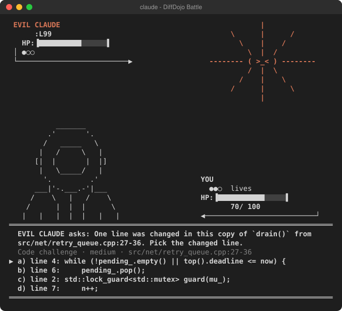

# DiffDojo

**Learn from the code Claude writes for you — while it writes it.**

<p align="center"></p>

When Claude Code is busy working on your project, you're usually just waiting. DiffDojo turns that waiting time into practice: after each change Claude makes, it asks you a few short questions about *that exact change*. Answering them means you actually review and understand the code instead of skimming it.

> DiffDojo is an independent, open-source plugin for Claude Code. It is not affiliated with or endorsed by Anthropic.

Everything runs on your machine. No accounts, no servers, nothing uploaded.

---

## What kind of questions?

**Code challenges** — built from the code Claude just changed
- *Spot the bug:* DiffDojo copies one of Claude's functions, quietly breaks one line, and asks you which one.
- *Predict the output:* what does this function return for this input? (DiffDojo actually runs it to know the answer.)
- *Write a test:* write a test that would catch a hidden bug in this function.

**Design questions** — about the choices Claude made
- What data structure did Claude use here? Which file owns this logic now? What calls what?
- *Why did Claude do this?* — checked against what Claude actually said in your session.

**Concept quizzes** — on the topics you're working in
- 200+ hand-written questions on C++, concurrency, Linux networking, Python, JavaScript/TypeScript, and algorithms. Writing epoll code? You'll get epoll questions.

Every answer is checked against real evidence — running the code, reading it, or reviewed answer keys — not guesswork.

## Battle mode

While Claude works, questions turn into a retro turn-based fight above your prompt, in the style of old handheld RPG battles with original ASCII-art characters, drawn right on your terminal in its own colors. The screenshot at the top is a real frame: Evil Claude, the final boss of Professional mode, asks about a line in the change Claude just made.

- **Up/down to pick an answer, Enter to attack.** A correct answer hits the enemy; a wrong one lets it hit you (and sometimes it misses).
- Beat an enemy and your HP is fully restored for the next one. You have **3 lives**: lose them all and you start the ladder over.
- **Modes:** Easy, Medium, Hard, **Professional** (whose final boss is **Evil Claude**, an angry orange starburst) and **Endless** (waves get stronger; your best wave is recorded).
- **Animated:** enemies slide in with a "wants to fight!" intro, every sprite has an idle loop, hits shake and flash the target, HP bars drain, and the text box arrow blinks.
- **Questions about Claude's code** are generated in the background while it works (from each edit, and again when the turn ends), and they show up in the fight: Professional mode asks them first.
- Battle answers count like any other: XP, belts, stats, plus a trophy for clearing each ladder.
- In Claude Code: `/battle` opens it any time, `/battle menu` picks a new mode, `/battle off` switches back to the plain question box. Esc returns to your prompt.

## Try it without prompting Claude

```bash
diffdojo demo      # makes ~/diffdojo-demo: a small project with a simulated Claude change, already turned into questions
cd ~/diffdojo-demo
diffdojo battle    # play the battle right in this terminal (no Claude Code needed)
```

Or open the demo in Claude Code (`claude --plugin-dir /path/to/Diffdojo`) and type `/battle` or `/dojo`. No need to ask Claude for anything first. `diffdojo battle` works in any project, too; `diffdojo battle --snapshot` prints a few frames instead of playing.

## Earn your belts

Correct answers earn XP. XP unlocks **belt exams** — White → Yellow → Orange → Green → Blue → Brown → Black — separately for each topic (C++, Python, Networking…). Higher belts unlock harder challenges like **boss fights** (find 3 hidden bugs in one file) and **audit mode** (is there a bug at all?).

The biggest reward? **Catching a real bug in Claude's code** and proving it with a failing test. That earns a trophy and a saved bug report.

Show it off with `diffdojo badge`, which makes a little SVG badge for your GitHub profile.

---

## Getting started

**You need:** [Node.js](https://nodejs.org) 22.5 or newer and git. That's it — no `npm install` required.
*(Optional: Python and a C++ compiler unlock more question types.)*

**1. Install the plugin**

In Claude Code, type:

```
/plugin install diffdojo --marketplace Ninjacornix/Diffdojo
```

Answer `y` to add the marketplace and pick a scope (user is the usual choice). From a shell, the same thing is `claude plugin install diffdojo --marketplace Ninjacornix/Diffdojo`. In the desktop app: click + next to the prompt box, then Plugins, Add marketplace with `Ninjacornix/Diffdojo`, then Add plugin.

Updates arrive with `/plugin` (or `claude plugin update diffdojo`).

**2. Or run it from a checkout** (for hacking on DiffDojo itself)

```bash
git clone https://github.com/Ninjacornix/Diffdojo.git
cd your-project
claude --plugin-dir /path/to/Diffdojo
```

For the terminal commands (`diffdojo quiz`, `diffdojo battle`, `diffdojo demo`) run `npm link` in the checkout, or use `node /path/to/Diffdojo/bin/diffdojo <command>`. Inside Claude Code the plugin puts `diffdojo` on the Bash tool's PATH by itself.

**3. That's it — it's already on**

DiffDojo starts automatically in every git project you open with the plugin enabled; there's nothing to switch on. Your XP, belts and trophies are tracked across all your projects (`diffdojo stats` shows them, plus a list of every project).

Optional: tell it how to run a project's tests, which unlocks more question types:

```
/diffdojo:start npm test
```

Don't want it in some project? Type `/diffdojo:stop` there. Prefer to opt in per project instead? Run `diffdojo config set autoEnable false --global` and use `/diffdojo:start` where you want it.

**4. Keep working — questions pop up right inside Claude Code**

While Claude is working, the current question appears in a box just above your prompt:

```
╭──────────────────────────────────────────────────────────────╮
│ DiffDojo · Design · Data structure · verified · 10 XP     │
│ `jobs` is declared in sched.py:8 in Claude's change. What is it? │
│ 1 a) dict                                                    │
│ 2 b) list used as a binary heap (heapq)                      │
│ 3 c) set                                                     │
│ 4 d) tuple                                                   │
│ Press 1-4 in the empty prompt · Skip  Snooze  Bad question  Hide │
╰──────────────────────────────────────────────────────────────╯
```

- **Multiple choice:** just press **1–4** while your prompt is empty.
- **Typed answers** (line numbers, outputs): press **ctrl+x tab** to jump into the answer box, type, and hit Enter.
- **`/dojo`** opens a side pane with the full question and its code.
- The status line shows how many questions are waiting, and a small pop-up tells you when new ones arrive.

Questions about a change appear shortly after Claude finishes it; in between, you get concept quizzes on the topics you're working in. Answer whenever you like, or not at all — none of this is ever shown to Claude.

**Prefer a separate window?** Use `diffdojo quiz` in a second terminal, or `diffdojo serve` for a browser page.
*(No `npm link`? Use `node /path/to/Diffdojo/bin/diffdojo quiz`.)*

---

## Handy commands

| Command | What it does |
|---|---|
| `/dojo` (in Claude Code) | Open the quiz pane beside the chat |
| `diffdojo quiz` | Answer your queued questions in a terminal |
| `diffdojo quiz --topic networking` | Practice a topic — no Claude session needed |
| `diffdojo stats` | Your belts, XP, accuracy, streak, trophies and projects — across everything (`--repo` for just this one) |
| `diffdojo review` | Retry questions you got wrong |
| `diffdojo exam cpp` | Take your next belt exam in a track |
| `diffdojo serve` | Quiz in your browser (local only) |
| `diffdojo badge` | Make a badge for your profile |
| `diffdojo doctor` | Check that everything is set up right |

While quizzing: type your answer, or `s` to skip, `z` to snooze, `b` to flag a bad question, `q` to quit.

In Claude Code: `/diffdojo:start`, `/diffdojo:stop`, `/diffdojo:stats`, `/diffdojo:report-bug`, `/diffdojo:topics`.

Run `diffdojo help` for everything else.

---

## Your data stays yours

- **Your choice where it runs.** It's on in every git project by default; `/diffdojo:stop` turns it off for one project, and `diffdojo config set autoEnable false --global` makes it opt-in everywhere.
- **Local only.** Everything is stored in `~/.diffdojo/` — never in your repo, never uploaded.
- **Never slows Claude down.** All the work happens in the background, after Claude finishes a turn.
- **Never talks to Claude.** Nothing is ever injected into your conversation.
- **Safe with your code.** Code only ever runs in a temporary copy, and the only project command DiffDojo will run is the test command you gave it. Files like `.env` and keys are skipped, and anything that looks like a secret is filtered out.
- **You're in control.** `diffdojo export` gives you all your data as one file; `diffdojo purge --yes` deletes it.

**Optional AI-written questions:** DiffDojo can use your own Claude plan to write extra questions (`diffdojo config set model.enabled true`). This is **off by default**. When on, small code excerpts are sent to Claude under your account's normal terms — keep it off for confidential code.

---

## Contributing

Contributions are very welcome — especially **new quiz questions**! Packs are simple YAML files in [`packs/`](packs/). You can also keep your own private packs in `~/.diffdojo/packs/`.

```bash
npm test          # run the test suite
npm run pack-ci   # validate all question packs (and run their code snippets)
```

Want to know how it works under the hood? See the design docs:
[Product requirements](docs/PRODUCT_REQUIREMENTS.md) ·
[Architecture](docs/ARCHITECTURE.md) ·
[Questions & grading](docs/QUESTIONS_AND_GRADING.md) ·
[Rewards](docs/REWARDS.md) ·
[Privacy & security](docs/PRIVACY_AND_SECURITY.md) ·
[Roadmap](docs/ROADMAP.md)

## Status

Version 0.1 — early, but working. Tested on Windows with Node 24; Linux and macOS should work but haven't been tested yet. Found a problem? Please [open an issue](https://github.com/Ninjacornix/Diffdojo/issues).

## License

[MIT](LICENSE) — free to use, change and share.
